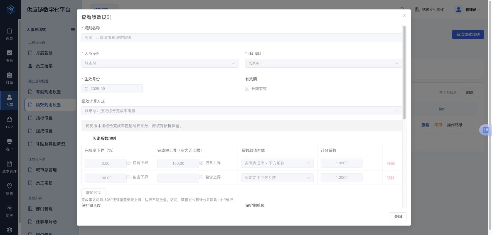
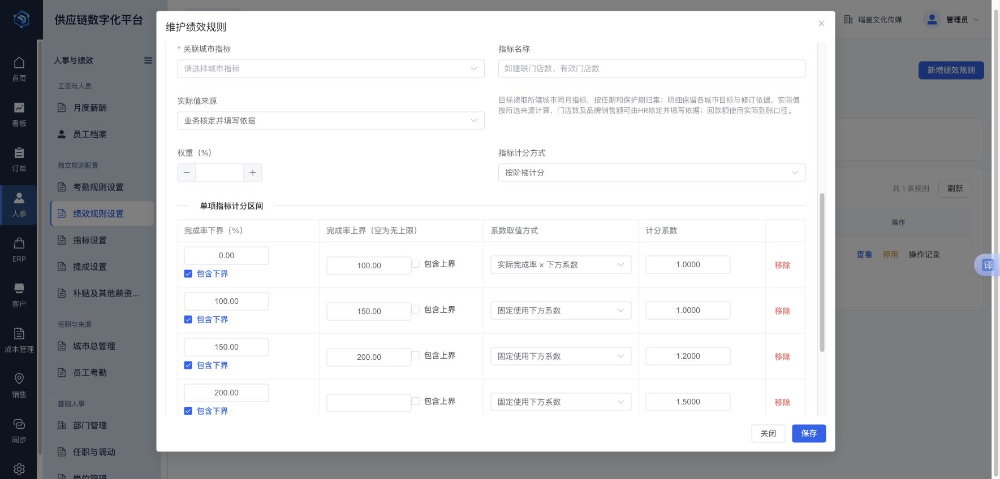
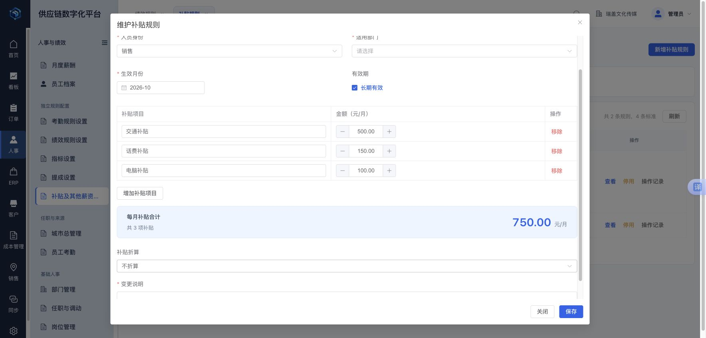

# 考勤规则月历验收（2026-10-19）

final result: passed

## 范围和视觉依据

- 用户要求：将考勤规则改为所提供的连续月历样式，去掉独立的“每周工作日”星期勾选。
- 视觉来源：用户附件“截屏2026-10-19 下午5.13.24.png”，原样留存于 [reference.png](docs/qa/attendance-calendar/reference.png)。
- 原页面附件“截屏2026-10-19 下午5.12.48.png”用于识别要移除的控件，不作为目标样式。
- 实现：现有 `/supply-chain/hr/attendance-rules` → 薪资考勤规则 → 新增／查看／调整规则。
- 文件：`PayrollSchemeCalendarEditor.vue`、`HrDateCalendar.vue`、`PayrollComponentView.vue`。
- 本次修改正式 Portal 页面，没有新增业务路由、接口或数据库变更。

## 对照证据与状态

- [完整页面截图](docs/qa/attendance-calendar/desktop.png)：1768 × 848 像素，包含系统导航、部门工作日历标题、操作说明、月历与下方归日窗口。
- [整月区域截图](docs/qa/attendance-calendar/calendar.png)：1168 × 624 像素。
- [日期与色条细节](docs/qa/attendance-calendar/first-weeks.png)：1168 × 270 像素。
- 浏览器：现有登录会话的 Chrome；CSS 视口 1768 × 848，运行时 DPR 为 2，但截图工具输出为 CSS 尺寸，文件无需再减半。
- 来源截图为 1326 × 448 的局部月历，来源 CSS 尺寸／DPR 未知。以完整七列网格作为对齐边界，排除浏览器外框，按列宽比例比较整体和前两周细节；未声称像素级复刻或精确字号一致。
- 对照状态：2026 年 10 月。新建表单手动将 1–7 日标记为休息日，以检查跨周连续色条；这些操作未保存，属于交互验收数据，不代表企业正式休假安排。
- 来源图、整月截图和前两周细节已放在同一次图像输入中对照查看。

## 五项视觉检查

| 检查面 | 结果及有意保留的差异 |
| --- | --- |
| 字体与层级 | 使用现有系统中文字体。日期位于右上方、农历位于左侧，日期较状态文字突出；没有覆盖和截断。字号按现有表单密度设置，未引入另一套字体。 |
| 网格与间距 | 七列连续网格替代独立圆角日期卡片；邻月日期补齐行并置灰；周末使用浅背景。沿用系统周一开头，参考图为周日开头，此差异为保留现有使用习惯。 |
| 色彩与状态 | 用系统蓝色色条标记休息日，取代来源图的紫色事件条；相邻休息日期横向连贯。工作日、休息日同时有文字，非本月日期不可操作；当天日期以蓝色下划线标识。 |
| 图标与图像 | 月份箭头使用已有 Element Plus 图标，月份选择器沿用系统组件。该区域没有需要重新生成的图片资产。 |
| 业务文案 | 删除“每周工作日”勾选及“按每周工作日重置本月”。新增“清除本月休息安排”；列表改为“工作日安排／按日历配置”。只读状态说明为查看安排，避免引导点击修改。 |

参考图的节假日名称、节气名称及自动放假／补班数据未接入。农历由浏览器国际化日历换算，仅用于辅助识别日期，不参与考勤计算。部门休息安排仍来源于保存的考勤规则。

## 交互和计算兼容检查

- 新建规则：默认工作日 31 天、休息日 0 天；点击 1–7 日后为工作日 24 天、休息日 7 天。
- 切换至 11 月后为 30 个工作日；切回 10 月仍保留 7 个休息日。
- 清除本月休息安排后为 31 个工作日；不清除其他月份的记录。
- 邻月日期置灰、禁用，不把邻月空白误当作当前月份的工作安排。
- 已有测试规则只读回显：2026 年 9 月显示 22 个工作日、8 个休息日；日期按钮禁用，保留历史周排班结果。
- 自动测试覆盖从 12 月切换至次年 1 月、跨月日期保留、取消点选、禁用状态、历史周末改为工作日、清除本月时保留跨月例外。
- 页面级测试使用真实 Vue／Element Plus 表单组件，模拟保存接口，确认选中的休息日期通过原 `calendar.restDays` 契约提交；未在共享数据库创建验收规则。
- 历史 `weekdays` 和大小周配置仅作为旧规则的计算依据保留；月历修改转为既有 `restDays`／`workDays` 日期例外，不批量重写历史规则。
- 个人免考核和考勤异常仍使用共享日历的原紧凑模式，不切换为部门大月历。

## 检查记录及边界

1. 首轮代码检查补充了只读文案及列表文案，使查看／编辑／列表语义一致。
2. 首次相关回归发现旧测试的考勤 API mock 缺少 `attendanceMonth`，已补齐测试替身，并增加日历保存接口断言。
3. 完成同输入视觉对照后，未发现本桌面范围内需要修复的 P0／P1／P2 问题；本次没有视觉修复后未经重拍即通过的情况。
4. `vitest`：3 个测试文件、14 项测试全部通过。
5. 修改文件的 ESLint、格式检查、`git diff --check` 通过；`pnpm build`（包含全项目 TypeScript 检查）通过。构建保留既有大包体积提示。
6. 浏览器错误日志只有此前员工页面的扩展消息通道错误，未捕获月历组件错误。
7. 已尝试窄屏视口设置，但实际页面仍报告 1768 × 848；已恢复视口设置。本报告仅确认桌面视觉结果，未将该次尝试计为窄屏验收通过。
8. 未执行实际规则保存、历史工资重算、生产发版或数据库迁移；本次页面保存路径由模拟接口测试验证。

## 后续检查

- 业务人员在原“考勤规则设置”入口核对新月历的工作／休息日期后，按原有规则发布流程保存。
- 如后续接入节假日数据，需单独定义数据来源、年度维护及部门覆盖方式，避免将参考图直接当成企业排班数据。

## 人事薪酬旧文案与现行逻辑一致性检查（2026-10-21）

本节是本次实查结果；上文月历描述是当时快照，当前法定日历接入状态以 Platform `docs/PROJECT_CONTEXT.md` 的后续记录为准。

范围：绩效规则新增、查看、列表筛选，月度薪酬核定与计算说明，员工薪资和补贴相关组件。使用当前 localhost Portal、已登录 Chrome 独立验收标签页；没有保存规则、重算或确认实际工资，没有修改数据库或重启服务。

### 发现与处理

| 问题 | 处理结果 |
| --- | --- |
| 总部规则仍显示“固定绩效”，列表没有总部人员筛选 | 改为“按个人月度完成率”；补全身份筛选、个人公式、绩效基数维护位置和月度核定位置。适用部门只限定规则范围，不新增部门共用完成率字段。 |
| 工资组成仍使用泛化的绩效说明，城市总一律写“综合系数” | 总部说明带本人当月完成率；城市总按快照区分单项加权发放比例与历史综合阶梯系数。人工覆盖仍优先展示核定说明，金额取后端快照，不在前端重算。 |
| 完成率缺失被归为销售打卡问题，金额提示还指向旧“当月核定”入口 | 单独列出个人月度完成率待核定，提供“核定薪酬”入口；所有金额核定提示使用同一面板名称。 |
| 不计绩效仍被归为固定绩效或销售绩效 | 列表、工资组成及绩效明细按实际 NONE 模式展示，避免套用完成率、打卡或城市总公式。 |
| 历史城市总规则的列表、保护期和目标来源说明被统一写成新口径 | 明确标出历史算法，保留该版本实际来源、目标与系数，修复“历史最高倍数”前多出的字符。 |
| 规则内容较长后，保存按钮滚出屏幕 | 规则弹窗限制为视口高度，正文滚动，标题和底部操作固定；总部说明、城市总区间和补贴表单均复查。 |

### 步骤与当前界面证据

1. **总部规则：已修正。** 在总部筛选下新增，默认选中个人月度完成率，显示“个人绩效基数 × 本人当月绩效完成率”，并说明未填写时待核定、按人按月录入。本次没有在规则上放置实际完成率输入框。

   

2. **月度薪酬：现有统一核定入口可用。** 实际打开一条未确认工资的核定面板，提成、底薪、最终绩效、补贴、扣款和统一说明在同一处。只读打开后取消，未提交。包含个人薪酬的截图仅保留在本机，未加入 Git。总部完成率的真实业务录入未验收，因为当前所查数据没有总部规则/工资样本；按人按月的填报、校验与保存使用隔离测试验证。

   本机核查原图：`/tmp/rigour-hr-ui-audit-20261021/02-monthly-determination-private.png`。

3. **已有城市总规则：识别出存量旧配置，展示已修正。** 当前可见城市总规则注明用于测试，仍保存综合阶梯系数和整单付清来源。这是存量配置，不是前端缓存。本轮没有将其改成全部有效到账，也没有改变已确认、已发放工资。

   

4. **新建城市总规则：当前实现可用。** 新增指标显示关联城市指标、实际来源、权重和单项计分方式，区间及 1、1.2、1.5 等示例系数可由 HR 修改；本次仅增加未保存的草稿指标，退出时放弃修改。

   

5. **补贴规则：现有合计展示正常。** 三项默认补贴合计 750 元/月以独立汇总区展示，正文滚动时保存按钮仍可见。该金额来自新表单默认示例，未保存为新业务规则。源码另核对员工薪资中的个人试用比例、保护期和月内调薪入口，未执行实际员工档案修改。

   

### 验证与边界

- Portal 六类定向测试共 53 项通过：规则、统一核定、工资组成、待处理分组、流程操作和导出；覆盖历史口径保留、个人完成率为零/缺失、人工覆盖优先和 NONE 模式。
- HR 两类定向测试共 16 项通过、无跳过：个人月度完成率计算、同部门不同员工独立核定、统一保存与事务冲突回滚。本轮没有修改后端业务代码。
- 最终 `pnpm build`（含完整 TypeScript 检查）、本轮修改文件的 ESLint 与 `git diff --check` 通过；构建仍有既有的大包体积提示。
- 桌面实际视口 1768 × 848；所有入库的页面截图在保存后重新打开检查。标题、公式和固定操作区可见；没有进行完整键盘、读屏、对比度或移动端验收。
- 未发现新增路由的必要，不改变规则状态权限。当前总部规则列表为空属于待配置业务数据；存量规则采用新口径需要按规则生命周期另行维护，不能用修改展示来代替发布规则。
- 本次不代表全系统回归、生产发布或实际员工工资验收通过。

## 成本与人事菜单统一为 ERP 折叠样式（2026-10-29）

final result: passed

### 范围与证据

- 用户视觉依据：[ERP 菜单截图](docs/qa/menu-sidebar-2026-10-29/reference.png)，原图 492 × 1064 像素；这是局部截图，无法据此确认原浏览器完整视口或截图密度。
- 实时样式基准：[现有 ERP 侧栏](docs/qa/menu-sidebar-2026-10-29/erp.jpg)。在同一已登录 Chrome、1768 × 848 CSS 像素视口、DPR 2 下，截取 x=76、y=70、宽 220、高 778 的菜单区域。截图工具输出为 220 × 778 像素，无需减半。
- 实现对照：[成本管理](docs/qa/menu-sidebar-2026-10-29/cost.jpg)、[人事与绩效](docs/qa/menu-sidebar-2026-10-29/hr.jpg)，均为相同视口和裁剪区域。成本选中“进货记录”，人事选中“提成设置”。原 ERP 图展开供应商分组，未选中业务页面；选中态按现有 ERP 菜单组件的交互规则验收，不将这一状态差异当作样式偏差。
- 用户原图、实时 ERP、成本与人事截图已在同一次图像输入中对照；最终移开指针、去掉操作时的焦点干扰后，再将 ERP 与两张最终截图放入同一次输入复查。侧栏本身为完整目标区域，字号、箭头和缩进均可辨认，无需另做细节放大图。

### 发现、实现与视觉检查

- 改动前成本与人事使用小标题加平铺链接，菜单层级和 ERP 不一致。现将既有分组转换为前端展示节点，统一交给 `ConsoleNavTree` 渲染；删除专属小标题和紧凑行样式。
- 保留原分组名称、页面名称及 IAM 已授权的可见入口。展示分组不写入导航 Store，不新增路由、权限或数据库菜单；六项成本台账及 HR 报销原归属保持不变。
- 首次实现后对照未发现需要修复的 P0/P1/P2 问题；最终重拍仅规范焦点和指针状态，没有在视觉修改后省略复查。

| 检查面 | 结果 |
| --- | --- |
| 字体与层级 | 与 ERP 共用字体和组件：分组 15px、子项 14px；分组与页面层级清楚。四项成本分组以及“补贴及其他薪资设置”均没有文字截断。 |
| 布局与间距 | 二级栏宽 220px，分组行高 44px，子项行高 38px；复用图标间距、竖线、缩进和圆角。两处均无侧向溢出。 |
| 色彩与状态 | 使用现有浅蓝背景、深色文字、蓝色活动分组、白底选中子项及蓝色标记；保留键盘焦点轮廓。 |
| 图标与图像 | 分组复用 ERP 的 Element Plus 文档图标及既有展开箭头；无新业务图片、占位图或自制图标。 |
| 业务文案 | 原分组与入口名称保持不变；没有加入调试说明或改变业务功能。 |

### 验证结果与边界

- 浏览器验证：成本和人事分组展开／收起，同级互斥展开；Enter 键展开成本场地分组；子菜单跳转、活动组与子项高亮；整栏收起及从一级模块恢复显示。
- 已实际打开 `/supply-chain/cost/purchases` 和 `/supply-chain/hr/commission-rules`，没有执行新增、编辑、规则发布或业务保存。
- `console-dashboard`、`console-workspace-tabs`、`cost-navigation`、`hr-navigation` 共 4 个测试文件、21 项测试通过；覆盖既有可见菜单边界及工作区跳转。部分测试保留账户菜单的 Element Plus 替身组件提示，没有测试失败。
- 修改组件的 ESLint、`git diff --check` 和 `pnpm build`（包含全项目 TypeScript 检查）通过。构建仍有既有 PURE 注释、动态导入及大包体积提示。
- 浏览器未出现菜单相关 JavaScript 错误；错误日志中保留此前浏览器扩展的消息通道错误。
- 本次为桌面管理员会话验收；普通账号权限过滤沿用原实现并由既有测试覆盖，未另做普通账号、移动端或完整读屏验收。
- 本次仅调整 Portal 展示，未修改后端、数据库或部署环境。

# 人事与成本列表、详情及组织树验收（2026-10-29）

final result: passed

## 需求与实施范围

- 用户要求：参照订单列表改善人事、成本列表；独立字段拆列；菜单按业务重命名；详情一起优化；部门范围按真实组织树展示。
- 视觉依据：用户 10:44、10:46 的列表/菜单截图和 11:23 的部门范围截图；现有订单列表 `OrderListView.vue` 的表头、固定列、数值对齐与长文本规则。没有引入新字体或新图像资产。
- 人事分组：员工与组织、考勤管理、薪酬与绩效、员工报销。成本分组：商品成本、物流运输、场地租赁、营销推广。菜单、页签、入口搜索和页面标题共用展示名称，仍只组织 IAM 已授权资源。
- 列表：规则名称/编码、员工姓名/编号/部门/薪酬身份、商品/规格/单位/数量/单价、成本单号/城市/日期、物流发货方/收货方/承运方、部门名称/直属下级数、经营目标对象/编码/部门分开显示。金额右对齐，长文本可查看完整内容；列多时横向滚动，固定标识列和操作列。
- 详情：补贴、绩效、提成改为只读内容，分基本信息、适用范围、计算明细、变更记录；成本改为金额摘要和独立字段信息区；员工、考勤、月度薪酬详情统一间距、标题与信息样式。
- 补贴详情直接读取保存版本的折算方式，不复用编辑器对销售身份展示的当前默认口径；未设置金额保持未知。生效期间沿用既有生命周期计算，不改业务计算。
- 部门范围：列表弹层及详情共用组织树，只包含已选部门和真实祖先，祖先单独标注“仅展示层级”。选中父部门不会在展示时补选下级；缺失部门保留可辨识标记；循环层级明确提示错误。

## 本地视觉证据

CSS 视口 1768 × 848，Chrome 已有登录会话，截图为 CSS 尺寸。截屏包含业务/人事信息，留在本机验收目录，不加入 Git：

`/Users/guorongrong/.codex/visualizations/2026/10/29/01a1855e-926c-7021-9d2e-ada41313ed72/business-lists/`

- `hr-list-before.jpg` / `hr-list-after.jpg`：部门长名单不再撑高整行，字段独立成列。
- `hr-detail-before.jpg` / `hr-detail-after.jpg`：禁用表单改为只读规则档案；后续部门区域由同一组件替换成组织树。
- `department-scope-after.jpg` / `department-tree-popover-after.jpg`：由平铺名单改为组织层级。对照同次图像输入检查了层级、展开箭头、图标、缩进、数量和结构节点标识。
- `department-tree-detail-after.jpg`：详情展开部门组织树，真实祖先未计入已选数量。
- `performance-list-after.jpg` / `performance-detail-after.jpg`：考核权重、打卡/拜访目标及扣减独立字段。
- `commission-detail-after.jpg` / `commission-product-scope-after.jpg`：提成人员、计算方式、比例、金额和单位拆列，商品范围展开后显示分类、具体型号及排除项。
- `cost-list-before.jpg` / `cost-list-after.jpg`、`cost-detail-before.jpg` / `cost-detail-after.jpg`：进货记录和成本详情前后对照，保留历史业务字段和原有权限操作。

已在同次图像输入中对比改前/改后列表、详情和部门弹层。沿用系统蓝色、白底信息区、13px 台账文字及原有图标。没有遮挡、标签挤成竖行或横向滚动透字；列数增加后的横向滚动为字段拆分的预期结果。组织树保留内部滚动，不把全部部门挤在首屏。

## 交互与验证

- 浏览器实测：菜单新名称、列表部门弹层、Enter 打开弹层、详情部门折叠展开、只读补贴保存口径、绩效详情、提成详情和商品范围展开、成本进货列表/详情、物流拆列入口。
- 组织树真实展示到公司、总经办、销售部及城市层级；只选城市范围时保留未选祖先的结构标记。
- 13 个相关测试文件、122 项测试全部通过，涵盖菜单授权边界、Shell 页签、历史规则状态、折算展示、金额空值、组织树范围、员工、部门、岗位、考勤、经营目标及六类成本/报销查看权限。
- 本次修改文件 ESLint 通过；`pnpm build`（含 TypeScript 检查）通过。保留项目已有的构建分包体积提示。测试中的 Shell 组件 stub 告警不属于浏览器组件缺失。
- 浏览器另记录了一条消息通道关闭错误，来源未确认；本轮列表、详情和组织树交互未出现页面渲染错误。
- 仅做读取与展示验证，没有保存业务记录、确认/作废费用或核算/发放工资。没有数据库迁移或权限数据变更，也未做部署和全角色业务验收。桌面视口已检查；窄屏只保留响应样式，未作单独设备验收。

## 人事、成本页面整体复查与空值统一（2026-10-29 追加）

本节为本轮增量复查，接续上节列表、详情及菜单改造；本地实现完成，浏览器覆盖与限制分列如下。

### 本轮修复

- 新增共用的业务空值展示工具：空字符串、空金额、缺失时间及空操作人使用 ASCII `-`；真实的 `0`、`0.00`、前导零编号保留。缺失商品分类、排除分类和型号使用同一空值。保留“不计提”“待核定”“规则已停用”等业务状态，不将尚未核定的数据伪装成零。
- 成本详情为各类业务保留独立字段，规格、地址、合同编号等缺失时仍显示字段及 `-`。进货不附加损耗专属字段，损耗不附加进货单价。租赁起止日期、活动服务起止日期、外部单据号/日期/收发方、系统来源单据及配送站点名称/地址独立展示。
- 追加拆分薪酬准备、批量操作、提成订单证据、绑定复核、规则复核及经营目标修改记录中的姓名/编号、商品/规格、数量/单位、标准数值/计提单位、日期/修改人。列表与只读详情共用金额、时间、间距、信息区及有界滚动样式。
- 部门范围统一为 `SupplyDepartmentScope` / `SupplyDepartmentTree`。单个部门也可展开真实组织树，未选祖先仅展示层级，不计入适用范围。薪酬准备筛选同样使用真实组织树。城市负责人管辖城市是城市维度，继续展示城市范围，不按同名推造部门关系。
- 只读薪资、绩效、提成参数直接使用保存版本。补回总部个人完成率及历史城市总算法的说明，保留真实折算配置。发放凭证编号来自后端一个字段，未虚构拆成两个凭证字段。
- 月度薪酬限制在工作区高度内，表格自身滚动；固定表头、姓名、操作区和分页。状态、待处理类别数、规则复核、确认发放限制说明分列，操作按钮不换行撑高工资行。短桌面视口压缩汇总/筛选间距；较窄或极短窗口保留页面滚动兜底。
- 月度经营目标标题与菜单、页签统一，历史记录的指标、目标值、原因、修改时间和修改人独立展示。

### 实际覆盖

| 页面 | 当前浏览器检查 | 其他验证 / 边界 |
| --- | --- | --- |
| 员工档案、部门、岗位、城市负责人 | 各列表已打开；员工只读详情已打开 | 部门/岗位原入口为维护表单，未新增虚构的只读业务页；城市负责人仍跳转员工档案 |
| 员工考勤确认 | 列表、只读考勤详情已打开 | 保留打卡来源不可用、规则停用及待核对状态 |
| 考勤规则设置 | 薪资考勤规则列表、月度应出勤列表及单部门组织树已检查 | 当前月度样本可修改；月度只读面板由组件测试覆盖，未修改样本状态来制造只读记录 |
| 绩效考核规则、商品提成规则、员工补贴规则 | 三类列表、只读详情及部门弹层已打开；24 部门范围可内部滚动 | 字段空值、历史折算、商品范围和权限边界有测试覆盖 |
| 月度经营目标 | 城市列表及有历史数据的修改记录已打开 | 历史零值/空原因/空修改人新增回归测试 |
| 月度薪酬核算 | 工资列表、工资明细、生成前准备面板已打开 | 只打开面板，未试算、生成、确认、重算或登记发放 |
| 六类成本及员工报销 | 七类列表及各一条现有只读详情均已打开 | DRAFT/CONFIRMED/VOID 的只读查看权限由组件测试覆盖；未执行费用状态变更 |
| 任职调动、旧薪资方案入口 | 任职调动为既有占位页；旧方案为引导入口 | 没有将其计为已实现的列表/详情功能 |

### 当前视觉证据与滚动实测

本轮私有截图目录（包含人事及业务信息，未加入 Git）：

`/Users/guorongrong/.codex/visualizations/2026/10/29/01a1855e-926c-7021-9d2e-ada41313ed72/business-audit/`

已保存后打开检查的代表性截图：`05-payroll-list-after.jpg`、`07-payroll-1440x720-after.jpg`、`hr-payroll-detail.jpg`、`hr-payroll-preparation.jpg`、`hr-commission-rules-list.jpg`、`hr-allowance-rules-detail.jpg`、`hr-department-tree-popover.jpg`、`hr-monthly-attendance-tree.jpg`、`hr-target-history-detail.jpg`、`hr-employees-detail.jpg`、`hr-attendance-detail.jpg`，以及进货、损耗、物流、仓库/办公室租赁、营销和报销的详情图。最终日期/操作人及试用期空值补丁通过测试和构建验证，因下述登录限制未对所有页面重拍。

- 1768 × 904 视口：薪酬根区域 `clientHeight = scrollHeight = 778`；表体可视高度 169、内容高度 495。实际滚轮从 0 到最大滚动值 326，已到第 9 条；表头 Y=584.34375、分页 Y=825 前后不变，外层内容滚动值保持 0。
- 1440 × 720 视口：根区域高度与内容高度均为 594；表体可视高度 110，分页底部 675，仍在窗口内。只同时显示部分工资行，其余通过表内滚动访问；不承诺一屏显示全部记录。已清除临时视口设置。
- 列表部门弹层为真实父子层级；24 部门样本内部高度 320、内容高度 889，可滚动。月度考勤只有销售部时，显示公司 → 总经办 → 销售部，两个祖先标为“仅展示层级”。
- 开发热更新期间经营目标页面曾出现一次页面加载失败；完整重载后同一城市列表及实际历史记录可正常打开，新增组件测试通过。未将该瞬态直接判定为后端故障。
- 最后一次新标签页复查显示“登录续期暂时不可用”，重载进入认证流程后未取得新的完整业务页面。因此未将空列表截图计为分类字段验收证据，也未声称最终所有页面的认证复查通过。之前已完成的页面检查与当前源码/组件验证分别保留。

### 验证及交付边界

- 当前范围共 57 个测试文件、510 项测试。末轮并行运行出现多项同时长时间超时及工作线程通信超时；降低并发后通过 508 项，剩余两个超时用例位于 `cost-manual-records`、`hr-payroll-rules`，另行单进程复核，结果记录于末尾。
- 所有修改 Vue/TypeScript 文件 ESLint 通过；最终 `pnpm build`（含 TypeScript 检查）通过。保留已有的大包体积、动态导入等构建提示；`git diff --check` 通过。
- 没有修改业务计算、后端服务、数据库、Flyway、权限数据或部署环境。浏览器未保存业务记录，没有下载实际薪酬/费用导出；导出格式兼容由相关测试覆盖。本轮不代表普通账号、移动设备、完整无障碍或真实发放/成本确认流程验收。

最终复核结果：两个定向文件单进程复跑 86/86 通过；随后完整相关范围再次运行，57/57 文件、510/510 测试全部通过，耗时 20.34 秒，无跳过或未处理错误。日志 `/tmp/rigour-business-audit-complete-tests.log`。上述超时运行保留为过程记录，不作为最终通过结果。构建日志 `/tmp/rigour-business-audit-last-build.log`，修改文件 ESLint 日志为空错误输出。

本轮交付状态：本地代码与构建、相关测试通过；浏览器已覆盖的只读页面见上表，最终登录续期复查受限。新增项目文件已加入 Git 暂存区，现有修改保持未提交状态；未部署。

## 登录续期、薪酬布局及完整只读复查（2026-10-29 后续）

本节记录上节之后的实际修复和复验；此前“续期复查受限”的历史记录不作为当前结果。修改保留在本地，未部署。

### 当前实现

- 月度薪酬筛选拆为薪酬月份、员工姓名、员工编号、部门、薪酬身份，各有独立标签；查询和重置紧跟筛选项。部门筛选使用真实组织树。
- 处理阶段改为独立的轻量页签及数量徽标，支持方向键、Home、End，保留相同的服务端阶段筛选。生成月度薪酬、导出、刷新集中在列表工具栏；状态说明使用帮助按钮，金额单位移到表格底部。
- 汇总参照订单列表，使用有色顶边和浅底的五张紧凑卡片：核算人数、完整核算人数、待核定人数、应发合计、应付合计。金额不换行，汇总继续取服务端完整筛选结果，不用当前页求和替代。
- 删除“补充列”开关。表格保留工资组成、应发、应付和状态；待处理类别数、规则复核、确认发放限制、实际发放移至明细的“核对信息”，员工编号保留在明细基本信息中。确认工资移至“更多”，原权限、阻断原因和禁用条件保留。
- 工资表自身滚动，固定表头、姓名、操作和分页，减少竖向网格与按钮堆叠。查询/重置在短桌面宽度下保持同行。
- 提成列表与详情使用“商品名称”“规格”两列。指定型号读取 ERP 对应商品名称、规格，分类级标准保留维护名称；不从名称中猜测或拆出规格。多个名称/规格使用可展开摘要，缺失为 `-`。商品范围列简化为商品分类、指定规格数、排除分类、排除规格数；项数不冒充销售数量。
- 提成列表、详情、编辑器共用同一组选项：按回款比例、按数量、明确不计提。提成比例、单位提成和计提单位分列，保存的数值、单位和计算逻辑不变；薪酬明细导出的方式名称同时统一。
- 排查并统一其他表单/详情差异：绩效方式、实际值来源、保护期单位、区间内计分方式、打卡计数口径、提成归属/取值时点共用选项。总部、城市总新旧模式保持其保存模式；公式说明单独展示。沟通时长以表单的分钟展示，完成率区间以百分数展示；业绩档位金额不按完成率换算。销售历史规则未携带城市总参数时可正常查看。
- 员工任职时长、未知任职状态、空操作人统一空值；月度应出勤的修改时间使用共用北京时间格式。真实的零值和历史版本口径保留。

### 姓名、编号筛选的后端契约与实际结果

HR `PayrollQuery` 增加独立 `employeeName`、`employeeCode`，保留旧构造器及兼容用的 `keyword`。仓储分别按姓名、编号模糊匹配，两项组合为 AND；列表、汇总和导出复用相同条件与数据权限。汇总复制查询时携带新条件，未修改数据库结构。

用户已在 IDEA 重启 HR（26889）。现有登录会话实际验证如下，两条请求 `/hr/payroll`、`/hr/payroll/summary` 均返回 200：

| 查询 | 列表记录数 | 汇总核算人数 | 完整 / 待核定 |
| --- | ---: | ---: | --- |
| 仅姓名 | 1 | 1 | 1 / 0 |
| 仅编号 | 1 | 1 | 1 / 0 |
| 匹配的姓名和编号 | 1 | 1 | 1 / 0 |
| 姓名与另一人的编号交叉组合 | 0 | 0 | 0 / 0 |

重置后恢复 9 条。没有记录测试员工姓名、编号或认证令牌；列表、汇总、导出参数一致性另有组件和仓储测试。

### 登录续期：已确认结果和未确认原因

- 原先那次“登录续期暂时不可用”的具体失败响应未保留，本轮未复现同一故障，不能断言已找到历史根因。IAM 当前配置未使用临时加密密钥；没有修改 IAM、密钥、数据库或 Flyway。
- 已验证真实自然过期链路：业务请求 401 → `grant_type=refresh_token` 的 IAM token 请求 200 → 业务重试 200，页面继续使用。另做一次受控过期响应测试，真实续期同样成功，测试拦截随后全部清除。
- 修正前端错误分类：HTML/空的网关错误响应保留 HTTP 状态；成功响应不是合法 JSON 时按响应异常处理；超时、网络错误和 HTTP 错误分别提示。暂时异常保留会话，明确的 `invalid_grant` 继续走原失效处理。
- 保留续期并发合并、轮换令牌与退出竞态保护，没有盲目自动重复提交轮换 refresh token。诊断仅包含错误码、原因、HTTP 状态及耗时，不包含令牌、认证请求体或响应体。

### 本轮实际页面覆盖

| 范围 | 浏览器实际检查 | 保留限制 |
| --- | --- | --- |
| 员工、部门、岗位、城市负责人 | 四类列表；员工基本资料、任职、薪资标准与薪资历史页签；城市负责人跳转员工档案并选中管辖城市页签 | 未制造薪资历史记录；缺少可打开的单条薪资只读样本时由组件测试覆盖 |
| 考勤确认、考勤规则 | 考勤列表与详情、规则日历只读查看、月度应出勤列表与单部门组织树 | 当前月度样本可修改；未制造锁定记录来验证月度只读样本 |
| 绩效、提成、补贴 | 三类列表、各一条只读详情和 24 部门组织树弹层；最新商品名称/规格及计提方式再次实际检查 | 分类级标准没有具体规格时显示 `-`；历史与异常数据另有测试覆盖 |
| 月度经营目标 | 城市与销售列表；实际城市历史包含 5 条记录，经营指标、目标值、原因、时间、修改人分开显示 | 未提交指标修改 |
| 月度薪酬 | 列表、工资明细、“核对信息”、生成前准备面板；两种桌面尺寸及真实滚轮；姓名/编号四种组合 | 未试算、生成、确认、重算或登记发放 |
| 六类成本、员工报销 | 进货、损耗、物流、仓库租赁、办公室租赁、营销、报销共七类列表和各一条已有只读详情 | 没有执行业务状态变更；没有下载真实工资/费用导出 |
| 任职调动、旧方案入口 | 检查既有占位/引导页面 | 不将其计为已实现的列表与详情 |

成本七类详情均扫描独立字段，无空白 `dd` 或旧空值占位符；日期、规格、金额、数量、人员及来源字段分开。费用类型、运输方式、付款状态继续复用新增/编辑使用的业务字典，未发现另行改写枚举含义的情况。部门范围统一共用组织树组件，结构祖先不计入已选数量；城市管辖范围仍保留城市维度。

### 视觉、滚动证据

截图包含业务/人事信息，只保存在本机，不加入 Git：

`/Users/guorongrong/.codex/visualizations/2026/10/29/01a1855e-926c-7021-9d2e-ada41313ed72/business-audit/followup/`

- 1768 × 848：页面根高度与内容高度均为 722；表体可视高度 363、内容高度 495。滚轮由 0 到 132.5，表头 Y=357.5、分页 Y=775 不变，外层滚动为 0。主列可视宽度与内容宽度均为 1414。
- 最终 1440 × 720：页面根高度与内容高度均为 594；表体可视高度 235、内容高度 495。滚轮由 0 到 260.5，表头 Y=357.5、分页 Y=647 不变，分页底部 681；查询/重置均为 Y=160。该宽度工资表保留必要的横向滚动。临时尺寸和测试拦截均已清除。
- 已打开检查最终工资布局、短桌面截图、提成商品名称/规格列表及详情、绩效原始选项、组织树，以及七类成本详情的截图。`payroll-final-layout.jpg`、`payroll-1440x720-final.jpg`、`commission-product-fields-final.jpg`、`commission-product-detail-final.jpg` 为对应最终证据。
- 过程中销售绩效历史记录缺少城市总专用参数导致查看失败，已修正空值兼容并追加真实数据形状的回归断言；重新加载后的同一实际规则已能查看，显示沟通时长 10 分钟及正确选项。

### 最终验证与交付边界

- 前端相关完整范围 61 个测试文件、556 项通过；最终字段标签增量再做提成列表/详情定向验证。覆盖姓名/编号与汇总/导出一致性、组织树、字段空值、历史保存口径、商品名称/规格、权限/状态守卫、续期并发和异常响应。
- HR 定向 Maven 测试 8 项通过（仓储 5、访问控制 3，0 跳过），日志 `/tmp/rigour-payroll-filters-backend-tests.log`。
- 修改文件 ESLint、生产构建（含 TypeScript）和 Git 差异空白检查通过；保留已有大包体积提示。前端日志 `/tmp/rigour-final-complete-tests.log`、`/tmp/rigour-final-lint.log`、`/tmp/rigour-final-build.log`。
- 本轮未改业务计算、数据库、迁移历史、权限数据或部署环境，未绕过 Flyway。未保存成本/工资业务记录；普通角色、手机设备、全流程成本确认及真实工资发放仍不属于本轮验收。
- 新增项目文件加入 Git 暂存区；原有修改保留，未提交或推送。

## 2026-10-29 下午：摘要列表、完整详情、创建责任与原有流程复查

本节是后续实现和最终复查，覆盖上文早些时候的展示方案与验证快照。此前“本轮未改数据库”的记录仅适用于当时阶段；本阶段已正常执行 HR V28，详见下文。未改写历史验收结论。

### 最终展示与字段口径

- 列表按业务记录或规则版本展示关键摘要，完整配置在只读详情逐项展示。提成主表不再把全部商品规格展开成大行；实际 3 条规则的标准数为 6、0、7，合计 13，原先把空的“不计提”占位行计入 14 的问题已修正。
- 提成详情一行对应一个实际商品规格及提成人员，商品名称、规格、计提方式、比例、单位金额、单位分开。商品名称和规格始终来自同一个 ERP SKU，不分别聚合成两个“共 N 个”。提成方式复用新增/编辑原选项，不另造计算解释。
- 绩效身份、考勤规则类型、经营目标维度使用统一轻量页签；去掉规则主列表通用说明段落。员工主列表保留关键人事摘要，详情按基本资料、任职与薪酬、教育与联系、合同与收款、系统记录分组；订货宝账号单独页签，每行一个账号。
- 部门和岗位增加只读详情，原有编辑、删除及负责人等字段保留。部门名称与编码独立筛选，保留真实祖先链。规则部门范围统一为真实组织树，结构祖先不计入已选数；经营目标原字段是城市，使用“所属城市”，不伪装成部门。
- 考勤的跨日字段表示打卡日期归属窗口，详情明确为“打卡归属开始时间（包含）”“打卡归属结束时间（不包含）”“结束时间所在日”，不改称上下班时间。主表仅保留工作日历关键摘要。
- 真实缺失值使用 `-`，零和 false 保留。创建人已留 ID 但姓名无法解析时也不伪造姓名。读取失败仍与真实缺失区分。
- 进货、损耗、物流、两类租赁、营销、报销的主表保留各自关键业务摘要；数量、单价、面积、合同、来源、期间、凭据等完整字段仍在详情和原有导出中。去掉“补充列”开关，金额和类型标签按具体业务命名。

### 原有操作入口的回归与修复

- 发现并修正本次布局造成的真实回归：规则操作列曾从 260 缩至 200 像素，Element Plus 单元格的 `overflow:hidden` 和省略号截掉后面的操作。修复为 280 像素、独立可换行操作容器，取消操作容器的文本省略；规则状态列恢复足够宽度。
- 已停用规则直接展示“查看、修改、重新启用、操作记录”。五类规则（薪资、绩效、提成、补贴、考勤）均新增流程回归：修改 → 保存停用新版本 → 重新启用；待生效删除、在用停用、历史/废弃只读及权限守卫按原规则保留。
- 实际停用提成规则可打开编辑窗口，姓名字段可编辑，保留“保存为新版本，并保持停用”；重新启用可打开填写原因提示。验证后取消，未修改实际规则或状态。1768 和 1440 宽度均检查全部操作按钮位于单元格内，没有按钮被截断。
- 工资列表恢复直接可见的“确认工资”，不再放在“更多”里。保留核定薪酬、重新核算、撤回确认、补差、发放记录等原入口和权限条件。
- 实际不可确认样本的后台原因是“该员工当月考勤尚未确认，请先确认考勤后再确认工资、登记发放”；并非确认接口丢失。按用户要求，确认/发放入口可点击，点击后重新读取最新工资单：受限时弹窗说明原因，无限制时进入原有操作窗口。列表和详情使用相同入口。
- 保留考勤、月份、规则复核和后端最终状态校验；处理中仍防止重复点击。隔离测试覆盖考勤未确认、本月未结束、过期列表阻断已经解除、最新状态已变化等情况。实际样本已验证阻断提示弹窗与正常确认窗口均能打开，随后取消；没有确认工资或登记付款。

### 独立筛选的实际核对

| 范围 | 正例 | 交叉或不匹配条件 | 重置 |
| --- | --- | --- | --- |
| 员工姓名、编号、手机号、订货宝账号 | 四项匹配返回 1 条 | 换成另一人的编号返回 0 条 | 恢复 230 条 |
| 提成商品名称与规格 | 实际保存的 SKU 名称/规格返回 1 条规则 | 名称相同、规格不匹配返回 0 条 | 恢复原列表 |
| 进货商品名称与规格 | 当前样本按商品名称返回 1 条 | 加入不匹配规格返回 0 条 | 恢复原列表 |
| 物流发货方、收货方、承运方 | 三项同时匹配返回 1 条 | 发货方换成收货方返回 0 条 | 恢复原列表 |

当前进货样本没有已填规格，名称和规格均匹配的正例由隔离 ERP 仓储测试覆盖，未把缺规格样本当作通过该正例。后端新增独立过滤参数，列表/汇总/导出查询拷贝保留这些参数，条件相交而非混成 keyword 的 OR。提成商品目录覆盖全部规则引用的 SKU，过滤不限于当前页，并保留商品加载失败提示。

### 创建人、创建时间与 Flyway

- HR V28 新增规则版本与月度工资的创建人姓名快照，以及月度应出勤规则的原始创建人、姓名和时间。月度规则历史缺失值保持 NULL，不从最后修改人/修改时间回填。
- 创建人由认证上下文和 IAM 解析，客户端不能指定。新建工资写入原始创建信息；重算不覆盖。修改待生效规则保留原创建事实；新版本独立记录其创建人。同一请求对创建人姓名做缓存，避免批量生成时重复解析同一个人。
- 月度薪酬和五类规则列表、详情展示创建信息；城市任期旧规则接口补回已有创建人和时间。真实接口已确认返回相应字段。新建后姓名快照的完整落库由隔离测试覆盖，本轮没有新建真实规则/工资来制造验收数据。
- 用户在 IDEA 重启 HR、ERP、Order 后，配置对应 HR 数据库 V28 状态 SUCCESS，Flyway `validate` 成功。之后补查城市任期旧 DTO，用户再次重启 HR，真实旧规则接口已返回创建字段；第二次不涉及新迁移。
- 没有跳过 Flyway 校验，没有执行 clean、repair、自动 baseline 或 out-of-order，也没有修改已执行的 V/B 文件。V28 已执行，后续必须作为不可改写的历史迁移保留。

### 最终页面覆盖、滚动与证据

- 本阶段实际检查员工列表/基本信息/订货宝账号、部门与岗位只读详情、经营目标、绩效/提成/补贴/考勤规则详情、月度应出勤与工资核对信息；其余员工薪资/任职页签和考勤明细保留上阶段检查及本阶段完整相关组件测试。
- 七类成本各检查一条实际只读详情，独立字段数分别为进货 24、损耗 23、物流 26、仓库租赁 26、办公室租赁 26、营销 23、报销 25，均无空白 `dd`。只读样本中包含已有模拟/已作废记录，未把它们计为新业务验收。
- 最终 1440×720 工资页：页面可视/内容高度均 594，汇总区域 84.5；表体可视 235、内容 495，真实滚轮滚到 260.5，表头 Y=357.5、分页 Y=636 保持不变。1768×848 下表体可视 363。补充列已移除，金额分项仍在完整工资明细。
- 本机证据目录（包含业务、人事信息，不入 Git）：`/Users/guorongrong/.codex/visualizations/2026/10/29/01a1855e-926c-7021-9d2e-ada41313ed72/business-audit/followup/summary-review/`。
- 主要证据：`rule-actions-before-fix.jpg`、`rule-actions-after-fix.jpg`、`rule-actions-1440x720-final.jpg`、`stopped-rule-edit-final.jpg`、`department-scope-tree-final.jpg`、`payroll-confirm-block-popup-final.jpg`、`payroll-confirm-normal-final.jpg`、`payroll-summary-final.jpg`、`payroll-1440x720-summary-final.jpg`。其余文件按业务页与 `summary/detail` 命名。部分早期截图在弹层进入动画中拍摄，不作为最终静态视觉结论依据。

### 最终验证与边界

- 前端 63 文件、568 项相关测试全部通过，包含五类规则完整停用修订启用流程、确认/发放点击提示、独立筛选、权限、金额/导出口径、组织树、历史配置、登录续期并发及错误处理。日志 `/tmp/rigour-summary-complete-final-tests.log`。
- 修改文件 ESLint、TypeScript（包含测试源码）、生产构建及差异空白检查通过。构建保留既有大包体积提示。日志 `/tmp/rigour-summary-final-lint.log`、`/tmp/rigour-summary-final-build.log`。
- HR 两组互不重叠定向测试共 123 项通过（审计/仓储/考勤等 80，规则与工资流程 43）；ERP 9 项、Order 6 项通过，均为定向验证，不是后端全量测试。日志 `/tmp/rigour-hr-audit-final-tests.log`、`/tmp/rigour-rule-workflow-preservation-tests.log`、`/tmp/rigour-independent-business-filters-backend.log`。
- 登录自然续期的成功证据与原始历史错误未复现的限制仍按上节记录；本阶段未再改认证策略。IAM 缺失历史迁移的调查仍按用户要求暂停。
- 普通账号角色、手机设备、真实工资生成/确认/发放、真实成本状态变更和新下载导出文件未作为本阶段实际验收；相关流程有隔离测试，不能替代真实业务验收。
- 新项目文件均加入各自仓库 Git 暂存区；未覆盖其他修改，未提交、推送或部署。本阶段运行验证使用用户已有 IDEA 服务。

## 2026-10-29 考勤分区、费用责任人及分类筛选复查

### 本次实现

- 考勤确认分为“考勤核定、请假与异常时段、统计依据”，姓名、编号、部门、月份和系统统计集中于顶部；天数、缺卡与缺拜访次数、说明分别填写。保留 0 与留空的区别、半天精度、恢复统计、异常时段及原校验。只读详情分为核定结果、打卡与拜访依据、异常时段、原始打卡日期。补上明确的默认页签，避免命名页签未选中时正文空白；测试同时检查实际可见页签，不能仅检查隐藏 DOM 文本。
- 费用责任人与录入人分离：员工报销显示“报销人”，其余六类成本显示“费用负责人”；新录入可选择实际员工，详情、筛选、业务导出使用对应业务责任人。录入人/时间仍是认证上下文形成的系统留痕。历史未填负责人显示 `-`，不以录入人或城市负责人自动补造。
- ERP/Order 保存及确认时校验负责人员工和部门，并使用授权目录中的姓名快照。原有报销按城市、费用日期选择实际报销人的逻辑及跨城登记入口保留。没有更改费用城市或把人员自动改成当前操作人。
- HR 员工目录补齐库存费用动作的引用适配。实页发现直接复用 EMPLOYEE 对象过滤会使 INVENTORY 费用目录返回空数组，已修正：全范围库存费用授权可取得姓名/部门引用；受限仓库、地区、未绑定员工等不会扩大成全部人员，受限库存授权仅能引用本人。营销沿用原 EMPLOYEE 范围。普通受限角色的实际使用尚未验收，不能据管理员结果推断其可代录他人。
- 商品提成分类筛选使用 ERP 的真实父子关系，可勾选多个分类及子分类；父节点保持独立选中值（避免控件默认只返回叶子节点而漏掉直接归于父类的商品），选父类覆盖后代，按任一选中分支匹配，并和名称、规格在同一商品上组合过滤。排除分类、排除规格继续有效。
- 七类成本采用统一的阶段页签、紧凑汇总、列表、分页布局。金额、费用归属、业务责任人优先，数量、单价、供应商等次要列仍可横向滚动查看，完整字段保留在详情。修正分页区重复留白和单号前缀被截断，单位展示业务中文。操作列换行且保留查看/编辑/确认/作废/记录等原入口。
- 筛选按业务类别保留：商品名称/规格/供应商/仓库，损耗原因，运输环节/运输双方/承运方/运单，租赁场地/月/合同/出租方，营销事项/类型/收款方，报销事项/类型/月/报销人；通用费用归属、业务日期及付款状态保留。去除备注、技术来源、来源单号和重复分段筛选。运输环节和营销类型各使用一个独立下拉框，营销类型包含租户启用字典，不只限制为旧版五项。
- 人事规则只读详情和核算依据表不再显示版本字段或版本列；历史计算、并发校验、停用后修改和重新启用流程保留。创建人、创建时间仍展示。

### 实际页面验证

- 用户在 IDEA 重启 HR、ERP、Order，之后因库存负责人目录适配再单独重启 HR；本次没有新增迁移，也没有改写已执行的 V28 或跳过 Flyway 校验。
- 进货、损耗、物流、两类租赁、营销、报销各打开一条实际只读详情，核对筛选字段与业务字段；样本包含历史模拟/已作废数据，不代表新业务发生。
- 进货与物流实页目录各返回 232 个员工选项；进货可选择“马南 · 北京市”，未保存。按马南筛选，实际请求包含独立 ownerEmployeeCode，并返回无匹配记录；重置恢复原列表。报销按李四筛选返回 4 条，逐条均显示李四；管理员代录时可选择北京市、马南，未保存。
- 考勤以一条 2026-10 未确认记录为例，实际展示应出勤 18 天、打卡 0 天、系统缺卡 112、缺拜访 48；确认按钮在字典加载后可用。确认页三类入口和只读详情页签均可切换，原始统计保留；未提交任何考勤确认、工资确认或发放。
- 商品分类树根节点为快销品、台球周边、电子科技、高德业务；快销品展开显示方便面。勾选两个分支得到 2 条匹配规则，重置恢复 3 条。规则详情未发现版本标签，创建字段保留；停用规则“修改、重新启用”入口可见。
- 1440×720 成本页面，汇总高度 85px、分页 55px；矮窗口允许外层页面滚动，表体保留约 220～236px。物流表体内容高 330px，原生滚轮由 0 滚到 94，表头 Y=384 和分页 Y=664 均保持稳定。已清除测试用视口覆盖。
- 实页曾出现“身份服务暂时不可用”提示，目录重试后恢复，后续读取成功。本次不将页面验证当作身份服务稳定性验收，没有变更认证、授权开关或迁移校验策略。
- 证据保存在工作区之外（含业务及人事信息，不入 Git）：`/Users/guorongrong/.codex/visualizations/2026/10/29/01a1855e-926c-7021-9d2e-ada41313ed72/business-audit/followup/summary-review/owner-attendance-refine/`。最终文件含 `attendance-confirm-layout.jpg`、`attendance-readonly-layout.jpg`、`attendance-readonly-evidence.jpg`、`commission-category-tree-final.jpg`、`rule-detail-no-version-final.jpg`、`purchase-owner-unsaved.jpg`、`expense-beijing-owner-unsaved.jpg`、`cost-purchases-1440x720-final.jpg`、`logistics-1440x720-scroll-final.jpg`。

### 验证结果和边界

- 前端 63 文件、576 项相关测试通过；新增营销费用导出测试，确认责任人只导出一次，旧“经办人”空列移除，且不以录入人代替。最后的辅助标签修正后又跑成本 2 文件、83 项通过；父分类真实复选框交互补测后，规则文件 39 项再次通过。覆盖既有业务状态操作、考勤页签实际可见性、分类组合筛选、负责人赋值及筛选、金额/导出、权限和登录续期等。日志 `/tmp/rigour-business-final-63.log`、`/tmp/rigour-business-last-cost-tests.log`。
- 后端本次相关测试共 73 项：ERP 36、Order 23、HR 14（员工引用服务 6、库存授权范围 8），全部通过，无跳过；这些是定向测试，不是后端全量测试。日志 `/tmp/rigour-cost-owner-backend-tests.log`、`/tmp/rigour-owner-directory-scope-tests.log`。
- 修改文件 ESLint、TypeScript 和生产构建通过；构建保留既有包体积提示。最终日志 `/tmp/rigour-business-complete-lint.log`、`/tmp/rigour-business-complete-build.log`。两个仓库差异空白检查通过，新增文件加入各自 Git 暂存区。
- 未保存真实费用记录、考勤确认或工资状态变更；负责人落库及伪造部门拒绝由隔离测试覆盖。普通角色、真实新增后全链路对账及重新下载导出文件未作为本阶段实业务验收。未提交、推送或部署。

- 本轮结束时基线：Portal `2f84312dad22f07d4fd721150a1744d5f64e7f0d`，相对本地缓存上游 0/0；Platform `2e23d86b6d681e68665660b8a6ad7f0948b38cb5`，相对本地缓存上游领先 1、落后 0。本轮没有 fetch 或新增提交，两仓库保持修改状态，未覆盖原有工作。

## 2026-10-29 物流运费按运输环节分段

- 按本次用户要求，将物流页运输环节下拉框替换为标题旁的“全部、供应商 → 中心仓、中心仓 → 城市仓、城市仓 → 客户”分段页签。上一阶段关于单一下拉框的描述保留为历史，此项以本节为准；其他费用类型入口不变。
- 点击分段立即查询并回到第一页，与既有承运方、日期、费用归属、负责人、付款状态及记录处理阶段相交。列表与金额汇总取自同一次筛选响应，导出复用已应用条件，新增沿用当前运输环节；查看、编辑、确认、作废、操作记录保留。
- 实页三个环节各 2 条，已登记金额分别 60 / 180 / 35 元；全部 6 条、275 元。调拨环节叠加已确认后 1 条、180 元。新增默认运输环节已实际检查，取消未保存。真实新费用、状态变更与实际文件下载未执行；导出查询一致性、切段重置分页与新建默认值由组件测试覆盖。
- 1440×720 实页分段栏高 42px，与标题同行，没有重复运输环节下拉框；表体高 236px，窄窗口继续使用已实现的外层滚动。已清除视口覆盖，并恢复用户原先选择的城市仓 → 客户和全部记录。
- 4 文件、93 项相关测试通过；改动文件 ESLint、类型检查和生产构建通过。日志 `/tmp/rigour-logistics-segments-tests.log`、`/tmp/rigour-logistics-segments-lint.log`、`/tmp/rigour-logistics-segments-build.log`。构建仍有既有大包体积提示。
- 本轮仅改 Portal 的费用页面、既有测试及本记录，无后端、数据库或 Flyway 变更，无需重启服务；没有新增项目文件，没有提交或推送。证据保存在上一节目录中的 `logistics-segments-all-final.jpg` 和 `logistics-segments-1440x720-final.jpg`，包含业务资料，不入 Git。

---

# CRM 门店列表与地图验收 · 2026-10-27

当前布局验收见 [2026-10-28 紧凑布局与公共样式清理](docs/qa/crm-store/layout-qa-20261028.md)。以下为历史功能与视觉记录，不约束当前布局。

2026-10-28最新复核：用户已完成后台前端JS Key及安全码配置。修正Marker置顶方法名后，真实高德底图、门店落点、全页位置及列表/详情联动均已通过。详见[真实地图复验](docs/qa/crm-store/map-live-qa-20261028.md)。本结论限本地实际组件与演示门店，正式CRM数据联调尚未完成。以下为10月27日历史视觉验收记录，旧Key阻塞结论已被本次复验取代。

## 结论与阻塞

本地列表和详情交互符合本轮要求；地图的真实底图与定位仍未通过验收。本机高德 JS Key 的官方响应为 `USER_KEY_RECYCLED`（10013），不能据模拟 SDK 的自动化测试声称地图已在真实环境落点。页面明确显示密钥失效提示，可重试或切回列表。无需更改业务权限。

## 视觉依据与状态

- 完整源图：`/Users/ethan/.codex/generated_images/01a142a6-4292-7723-840c-343deefc5efe/exec-61011f14-24c5-433b-9f89-36f60809b2b5.png`（1487×1058）。
- 用户指定局部：`/var/folders/24/hnnvyxbn1s13bt4bjv9bl4m40000gn/T/codex-clipboard-066fa21d-766c-4d10-8037-a50c0ace18f1.png`（482×126）。
- 用户最新要求优先：恢复列表/地图切换、去掉查看按钮、店名打开详情、定位切到地图并聚焦门店。
- 浏览器实现：[list.png](docs/qa/crm-store/list.png)，重点区域 [store-cell.png](docs/qa/crm-store/store-cell.png)，地图阻塞 [map-key-blocked.png](docs/qa/crm-store/map-key-blocked.png)。
- 实现地址：`http://localhost:5100/docs/qa/crm-store/preview.html`。使用本项目真实组件、隔离演示门店、阻断业务网络写入，没有启动其他应用服务。
- Chrome 原视口 2560×1352；预览内容宽度1280 CSS px。浏览器原生裁剪得到1280×760主区域、400×84门店区域；裁剪不改变密度。没有将示意图当作业务界面背景。
- 源图含导航框架，实现截图仅比较内容区。门店数量、门店类型、日期、演示后缀不同；源图密度未知，不做逐像素一致性结论。
- 已把完整源图、实现截图、用户局部、实际单元格截图放在同一个比较输入中检查。

## 比较与修复记录

1. 首次浏览器检查：日期列115px包含内边距后换行（P2），扩大到132px；合作标签使用默认黄绿色（P2），调整为截图的浅绿色底与深绿色字。
2. 第二次联合比较：独立表头、名称/标签/定位层次与日期单行通过；认领使用文字链接弱于原图主操作（P2），改为小号主按钮。
3. 最后同状态捕获并联合比较：以上三项已修复。仍有地图 Key 失效的 P1 外部阻塞；不得把地图验收标记通过。

## 五项视觉检查

- 历史字体：采用系统中文字体，强调门店名称并弱化地址；字号随当前页面密度调整，不作为固定规范。
- 历史布局：当时采用双行门店信息和独立表头；间距、表格高度及筛选布局已由 2026-10-28 的自适应布局替代，不沿用旧尺寸要求。
- 颜色：白色表格、浅灰背景、蓝色操作、绿色合作标签、蓝色A/B标签；未评级与缺失数据使用中性状态。
- 图标：复用 Element Plus 定位和列表/地图图标；无位图伪装界面。底图真实素材因 Key 失效未可见，不作地图视觉通过结论。
- 文案：取消“查看”；全国范围来自授权上下文；没有数据的门店类型显示“未分类”，缺坐标显示“位置待完善”。地图清楚标注“当前页/筛选共”，没有把当前页标记数当成全国门店总量。

## 行为验证与检查

- 浏览器：定位按钮切换到地图且显示该店卡片；地图卡片店名进入详情；详情定位回地图；切回列表仍保留筛选、分页和标签；地图失败提示可见。真实地图中心/缩放尚待有效 Key 复验。
- 定向自动测试38项通过（5个测试文件）；覆盖导航权限、地区筛选、详情入口、切换保留状态、聚焦坐标、卸载取消延迟加载、WGS84展示转换失败不错误落点、SDK异步回调、失效Key处理。
- 定向 ESLint无输出；类型检查、生产构建通过。构建有既有依赖PURE注释和大包提示，不阻断构建。
- 浏览器控制台error日志为空；地图鉴权失败由SDK回调报告并呈现。未保存凭据或原始鉴权响应。
- 真实后端菜单发布、全国商家导入、权限配置、订单/拜访等尚未联调，不属于这个隔离界面通过证据。

## 后续验收清单

- 管理员在本地环境配置中更新有效的高德 JS API Key 与匹配安全码，按现有前端运行方式重新加载环境。
- 复验真实底图、目标门店中心、缩放16级、点击图钉及显示本页全部位置。
- 接入真实CRM权限与门店数据后再验收全国/杭州账号和真实分页。

地图异步加载与坐标转换依据：[高德JS API加载说明](https://lbs.amap.com/api/javascript-api-v2/guide/abc/load)、[地图状态](https://lbs.amap.com/api/javascript-api-v2/guide/map/state)、[坐标转换](https://lbs.amap.com/api/javascript-api-v2/guide/transform/convertfrom)。

上一份考勤月历验收原文已保留在 [历史报告](docs/qa/attendance-calendar/design-qa-20261019.md)。
